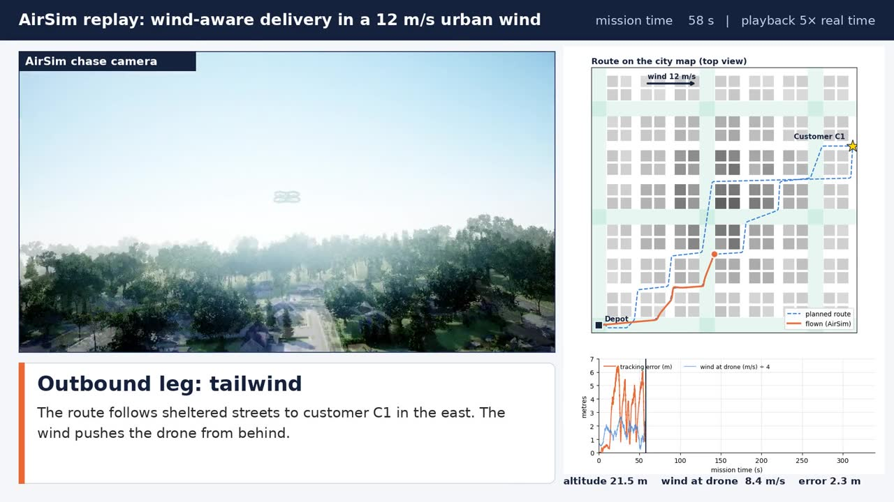

# Quadrotor Package Delivery through Urban Wind Corridors

Simulation code for the M.Sc. project *Quadrotor Package Delivery through Urban Wind Corridors* (Adeeba Mansoor,
University of West London). A delivery quadrotor flies from a depot to a customer, lowers and releases a parcel,
and returns, through a city whose streets and wide avenues channel the wind. Three route planners are compared
under winds of 4–16 m/s from eight directions:

| Planner | Picks cruise height and speed by | Knows the wind? |
|---|---|---|
| `shortest` | nothing: shortest route at 35 m, 8 m/s | no |
| `energy0` | predicted energy, assuming still air | no |
| `wind` | predicted energy in the urban wind map, refuses legs whose steady tilt would exceed 35° | yes |

Each planner is flown with two controllers, `pid` (geometric PID) and `dob` (PID + disturbance observer).
The flights are checked independently in **AirSim** (Unreal Engine) with the same wind injected at the drone.



## What is in the simulator

| File (`sim/`) | What it models |
|---|---|
| `city.py` | procedural city: 7 × 7 blocks, 196 buildings (≈11–70 m tall), streets and 36 m wide avenues (the wind corridors) |
| `wind.py` | urban wind: power-law profile, decay inside the street canyons, channelling along streets, speed-up on avenues, wakes behind tall buildings; Dryden-type gusts |
| `quadrotor.py` | 6-DOF quadrotor (1.6 kg + 0.6 kg parcel), motor lag, rotor and body drag, momentum-theory power model, geometric controller, disturbance observer |
| `planner.py` | grid A* (shortest or energy cost), path shortcutting, corner rounding, speed profile |
| `mission.py` | one complete delivery mission and the three planners |
| `run_experiments.py` | runs any set of missions in parallel, described by a YAML file in `configs/` |
| `summarise.py` | table + figures for one or several experiments |
| `fly_one.py` | flies one mission and plots its route, error, wind and energy |
| `airsim_replay.py`, `airsim_demo_record.py`, `airsim_demo_video.py` | AirSim check and demonstration video |
| `analyze.py`, `make_logs.py`, `figs_v2.py`, `demo_animation.py` | figures and tables of the dissertation |

## Quick start

The simulations need many CPU cores (the full campaign is 1,536 missions, ~45 min on 30 cores), so they are run
on a rented cloud machine from [Vast.ai](https://vast.ai) using the ready-made Docker image
[`abdulmannan617/quadrotor-wind-corridors`](https://hub.docker.com/r/abdulmannan617/quadrotor-wind-corridors).
The image contains Python, all packages, this repository and the AirSim Neighborhood map.

**Step-by-step for a first-time user: [docs/VAST_AI_GUIDE.md](docs/VAST_AI_GUIDE.md).**

Once you have a terminal in the container:

```bash
cd ~/quadrotor-wind-corridors && git pull          # get the latest code
cd sim
python3 run_experiments.py --config ../configs/quick.yaml        # 12 missions, a few minutes
python3 summarise.py ../results/experiments/quick/campaign.csv   # table + 2 figures
python3 fly_one.py --U 16 --theta 0 --planner shortest           # look at one mission
```

Without Docker (Linux/macOS, Python 3.10+): `pip install numpy scipy matplotlib pandas pyyaml` is enough for the
simulator (exact versions and the AirSim client: see `requirements.txt`), then the same commands. Small
experiments run on a laptop; use the cloud for anything over ~50 missions.

## Running your own experiments

An experiment is a small YAML file. Copy one from `configs/`, change it, run it:

```yaml
name: heavy_parcel            # results go to results/experiments/heavy_parcel/
grid:                         # every combination is flown
  U_ref: [4, 8, 12, 16]       # wind speed (m/s) at 60 m
  theta: [0, 90, 180, 270]    # direction the wind blows toward (deg)
  customer: [0]
  planner: [shortest, energy0, wind]
  controller: [dob]
  seed: [0]
vehicle:
  m_payload: 1.0              # kg (default 0.6)
```

```bash
python3 run_experiments.py --config ../configs/heavy_parcel.yaml
python3 summarise.py ../results/experiments/baseline_small/campaign.csv ../results/experiments/heavy_parcel/campaign.csv
```

Everything that can be changed (vehicle, planner, wind model, gusts, city) is listed with its default value in
[`configs/template_all_options.yaml`](configs/template_all_options.yaml). Full explanation, the output columns and
how to run many experiments in one go: **[docs/EXPERIMENTS.md](docs/EXPERIMENTS.md)**.

## AirSim

```bash
start_airsim                       # starts the Neighborhood map headless and waits for it (GPU instance needed)
cd ~/quadrotor-wind-corridors/sim
python3 airsim_replay.py --one     # flies the wind-aware mission in AirSim with the urban wind injected
stop_airsim
```

Details, the demonstration video and how it is made: [docs/AIRSIM.md](docs/AIRSIM.md).

## Learning path

New to the code? Work through **[docs/LEARNING_TASKS.md](docs/LEARNING_TASKS.md)**: seven short tasks, from the
first run to designing and reporting your own experiment.

## Repository layout

```
configs/      experiment files (YAML)
sim/          simulator, experiment runner, analysis, AirSim scripts
airsim/       AirSim settings and start/stop scripts
docker/       Dockerfile and build script of the image
docs/         guides (Vast.ai, experiments, AirSim, Docker, learning tasks)
results/      results of the dissertation campaign (campaign.csv, paired comparisons, AirSim summary);
              your experiments go to results/experiments/<name>/
outputs/      figures and tables made by analyze.py (created when you run it)
```

## Reproducing the dissertation results

```bash
cd sim
python3 run_experiments.py --config ../configs/thesis_full.yaml --out ../results/campaign.csv   # ~45 min on 30 cores
python3 make_logs.py && python3 analyze.py && python3 figs_v2.py                               # figures in outputs/
```

The campaign is deterministic (fixed seeds), so the same package versions (`requirements.txt`, used in the Docker
image) give the same numbers.

## Licence

MIT, see [LICENSE](LICENSE). The AirSim Neighborhood environment in the Docker image is part of Microsoft AirSim
(MIT licence).
